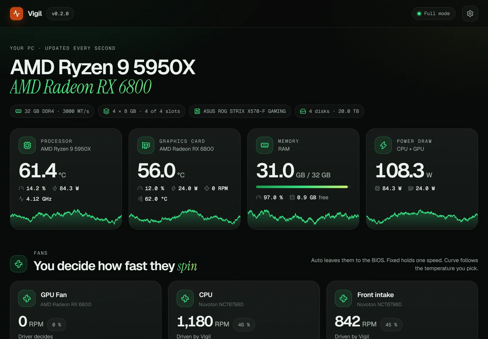
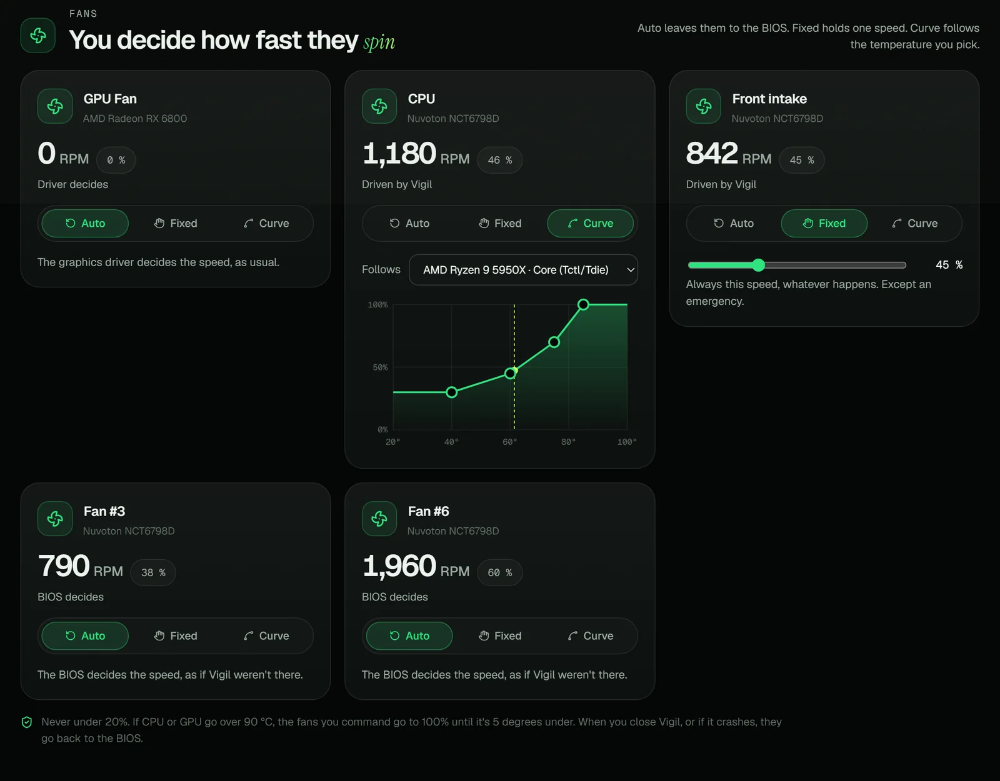
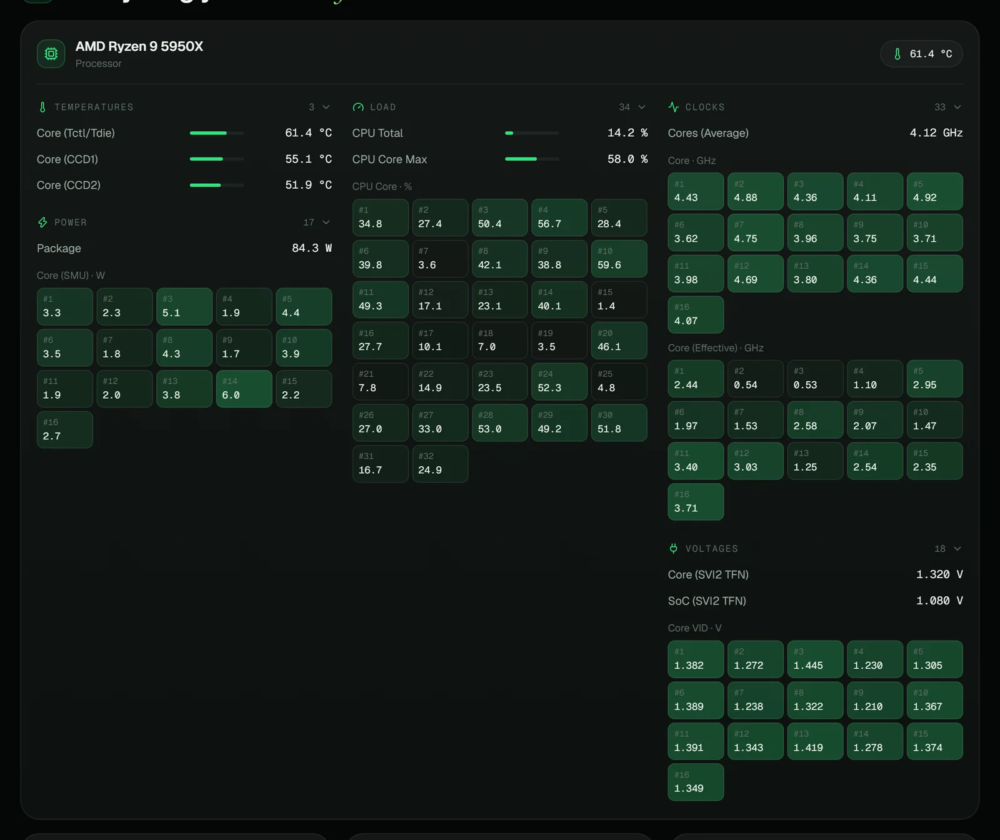

<p align="center">
  
</p>

<h1 align="center">Vigil</h1>

<p align="center">
  Watches your PC's temperatures, fans and power draw from the tray, and lets you decide how fast the fans spin.<br>
  <a href="#english">English</a> · <a href="#italiano">Italiano</a> · <a href="https://davide-mariotti.github.io/apps/vigil">Website</a>
</p>

<p align="center">
  <a href="https://ko-fi.com/Z0X32ATNHL"></a>
</p>

<p align="center">
  
</p>
<p align="center">
   
</p>

---

## English

### What it does

- Works out what's inside the PC by itself: CPU, graphics card, RAM sticks and slots, motherboard, disks. Nothing to set up.
- Puts the hottest temperature (CPU or GPU) in the tray, as a number: dark when all is well, amber within 10 degrees of your limit, red over it.
- Opens on a dashboard: CPU, graphics card, memory and power draw at a glance, each with its last 10 minutes. Below it, one card per component, sensors grouped by kind, and the 32 cores of a big CPU as a heat map instead of 32 rows.
- Draws the last 10 minutes of any sensor you click, right under it, with minimum, average and maximum.
- Drives the fans, if you want: *Auto* leaves them to the BIOS, *Fixed* holds one speed, *Curve* follows the temperature you pick, with points you drag. You can give each fan a name, because "Fan #2" tells nobody anything.
- Warns you when the CPU or GPU stays over your limit (90 °C by default) for more than a minute. Once per episode, not every second.
- Two modes, one exe. Started normally, it reads what Windows gives to anyone: CPU load, graphics card (temperature, power, fan), RAM, network. Started as administrator with the free PawnIO driver installed, it also reads CPU temperature and power, motherboard sensors and fans, disks, and can drive the motherboard fans.
- Starts with Windows if you ask it to. Turned on as administrator, it uses a scheduled task: full mode and your fan curves at every logon, no UAC prompt every morning.
- Speaks Italian or English, following the language of Windows.

### What it doesn't do

- It doesn't take risks with the fans. Never under 20%. If the CPU or GPU go over your limit, every fan you command goes to 100% until it's 5 degrees under. When Vigil closes, or crashes, the fans go back to the BIOS. If the probe a curve follows disappears, that fan goes back to the BIOS too.
- It doesn't install drivers behind your back. Full mode needs PawnIO: Vigil tells you when it's missing and opens its official site, you install it.
- It doesn't connect to the internet. No telemetry, no auto-updates, no account. The window is a page packed inside the exe, shown by WebView2, the Edge engine that comes with Windows 10 and 11. Settings live in `HKCU\SOFTWARE\VigilApp`, or in `Vigil.ini` in the portable version.
- It doesn't make up numbers. A sensor that only answers 0 without the driver is hidden, not shown as 0 °C.
- It doesn't eat memory in the tray: the window's engine starts when you open it and goes away when you close it.
- On many laptops it can't see everything: fans and some temperatures sit behind the maker's own firmware, each brand its own way. Vigil shows, and drives, what the maker lets through.
- It doesn't run on macOS, Linux, or 32-bit and ARM Windows.
- It doesn't cool your PC. A can of compressed air still does that better.

### Download

1. Download [Vigil.exe](https://github.com/davide-mariotti/Vigil/raw/main/Vigil.exe) (4 MB). Windows 10 or 11, 64-bit, nothing else to install.
2. Put it in a folder that stays put (say `Documents\Tools`), not in Downloads.
3. Double-click it. The first time, SmartScreen may complain because the exe isn't signed: *More info* → *Run anyway*.
4. For every sensor and the motherboard fans: *Restart as administrator* (in the window, or right-click on the tray icon). If Vigil says PawnIO is missing, *Get PawnIO* opens [pawnio.eu](https://pawnio.eu/): install it, then *Installed: restart*.

**Portable version**: [Vigil-portable.zip](https://github.com/davide-mariotti/Vigil/raw/main/Vigil-portable.zip) (1.8 MB), the same exe with a `Vigil.ini` next to it. Unzip it anywhere, a USB stick too. As long as `Vigil.ini` sits next to the exe, the settings are saved in that file and the registry is never touched. That's also why this version can't start with Windows.

### How to use it

- The **number** in the notification area, next to the clock, is the hottest of CPU and GPU in °C. Hover it to see both. Before the first reading, or on a PC with no temperature to show, you see the Vigil icon instead.
- Double-click the icon for the window, right-click → *Exit* to close Vigil. Closing the window leaves Vigil in the tray.
- Click a sensor, or a core in a heat map, to see its last 10 minutes. Move the mouse over the chart to read any moment.
- **Fans**: pick *Auto*, *Fixed* or *Curve* on each card. A curve has four points: drag them, and the dashed line shows where the temperature is right now. Click the fan's name to rename it.
- The gear at the top right opens the settings: start with Windows, temperature alerts and their limit. They're saved as you change them.

### How it works

Once a second Vigil:

1. asks every chip for its sensors through [LibreHardwareMonitorLib](https://github.com/LibreHardwareMonitor/LibreHardwareMonitor), the library behind LibreHardwareMonitor and FanControl;
2. hides what isn't real: sensors stuck at 0 since the start (empty fan headers, unused network adapters), unplugged probes reading 127 °C, and, without the driver, whatever the CPU and motherboard would answer (zeros, and a Ryzen that swears every core runs at 1.55 V);
3. picks the main temperature of each chip, the package for the CPU and the core for the GPU, and puts the hottest in the tray. Hot spots run 10-20 degrees higher and would ring the alarm in every game;
4. sets every fan you command: the curve's value for the current temperature, never under 20%, 100% in an emergency. Speeding up is immediate, slowing down goes 2% a second, so a fan doesn't hunt up and down with every spike. The value is sent again every second, because after sleep the BIOS may have taken the fan back;
5. if the CPU or GPU stays over your limit for a minute, warns you, then waits for it to drop 5 degrees under before warning again.

Why administrator: CPU temperature, power draw and motherboard chips are read through a kernel driver, and Windows lets only administrators talk to drivers. Vigil uses [PawnIO](https://pawnio.eu/), the signed driver LibreHardwareMonitor and FanControl moved to after Windows Defender started flagging the old WinRing0. The graphics card is the exception: its driver answers anyone, so its fan can be driven in base mode too.

### Build from source

No Visual Studio needed: Windows already ships the C# compiler of .NET Framework 4.

```cmd
build.bat
```

You get `Vigil.exe` and `Vigil-portable.zip` next to the sources. The libraries in `lib\` and the window in `ui\` (plain HTML, CSS and JavaScript, no build step) are packed inside the exe. `build.bat` runs `Vigil.exe --selftest`, which checks the rules that decide what's shown, when the alarm rings and what a fan is allowed to do. The icons come from `icon/make-icons.py` (Python, Pillow and Chrome), drawn with [Lucide](https://lucide.dev) glyphs, the same ones the window uses.

### Support

If Vigil caught a dying fan before your CPU did, or simply made your PC quieter, you can [buy me a coffee on Ko-fi](https://ko-fi.com/Z0X32ATNHL). That's how the next app gets written.

### License

[MIT](LICENSE). The libraries and fonts inside the exe keep their own licenses (MPL-2.0, Apache-2.0, BSD, MIT, SIL OFL): the list, with where to get their source, is in [lib/README.md](lib/README.md).

---

## Italiano

### Cosa fa

- Capisce da solo cosa c'è nel PC: processore, scheda video, banchi di RAM e slot, scheda madre, dischi. Non c'è niente da configurare.
- Mette nella tray la temperatura più alta tra CPU e GPU, come numero: scuro se va tutto bene, arancione quando sei a 10 gradi dal tuo limite, rosso quando lo superi.
- Si apre su un cruscotto: CPU, scheda video, memoria e consumo a colpo d'occhio, ognuno con i suoi ultimi 10 minuti. Sotto, una scheda per ogni componente, i sensori divisi per tipo, e i 32 core di una CPU grossa come mappa di calore invece che 32 righe.
- Disegna gli ultimi 10 minuti del sensore su cui clicchi, proprio lì sotto, con minimo, media e massimo.
- Comanda le ventole, se vuoi: *Auto* le lascia al BIOS, *Fisso* tiene una velocità, *Curva* segue la temperatura che scegli, con punti che sposti trascinandoli. A ogni ventola puoi dare un nome, perché "Fan #2" non dice niente a nessuno.
- Ti avvisa se CPU o GPU restano sopra il tuo limite (90 °C di base) per più di un minuto. Una volta per episodio, non ogni secondo.
- Due modalità, un solo exe. Aperto normalmente legge quello che Windows dà a chiunque: carico della CPU, scheda video (temperatura, consumo, ventola), RAM, rete. Aperto da amministratore, con il driver gratuito PawnIO installato, legge anche temperatura e consumo della CPU, sensori e ventole della scheda madre, dischi, e può comandare le ventole della scheda madre.
- Si avvia con Windows, se glielo chiedi. Se lo attivi da amministratore usa un'attività pianificata: modalità completa e le tue curve a ogni accensione, senza la conferma UAC ogni mattina.
- Parla italiano o inglese, in base alla lingua di Windows.

### Cosa non fa

- Non fa scommesse con le ventole. Mai sotto il 20%. Se CPU o GPU superano il tuo limite, tutte le ventole che comandi vanno al 100% finché non scendono di 5 gradi. Quando Vigil si chiude, o va in crash, le ventole tornano al BIOS. Se sparisce la sonda che una curva segue, anche quella ventola torna al BIOS.
- Non installa driver di nascosto. La modalità completa vuole PawnIO: Vigil ti dice quando manca e ti apre il sito ufficiale, lo installi tu.
- Non si collega a internet. Niente telemetria, niente aggiornamenti automatici, niente account. La finestra è una pagina chiusa dentro l'exe, mostrata da WebView2, il motore di Edge che c'è già in Windows 10 e 11. Le impostazioni stanno in `HKCU\SOFTWARE\VigilApp`, o in `Vigil.ini` nella versione portable.
- Non si inventa i numeri. Un sensore che senza driver risponde solo 0 non compare, invece di segnare 0 °C.
- Nella tray non si mangia la memoria: il motore della finestra parte quando la apri e se ne va quando la chiudi.
- Su molti portatili non vede tutto: ventole e alcune temperature passano dal firmware del produttore, e ogni marca fa a modo suo. Vigil mostra, e comanda, quello che il produttore lascia passare.
- Non gira su macOS, Linux, né su Windows a 32 bit o ARM.
- Non raffredda il PC. Per quello una bomboletta d'aria compressa resta imbattibile.

### Scaricarlo

1. Scarica [Vigil.exe](https://github.com/davide-mariotti/Vigil/raw/main/Vigil.exe) (4 MB). Windows 10 o 11 a 64 bit, nient'altro da installare.
2. Mettilo in una cartella che non sposti (tipo `Documenti\Strumenti`), non in Download.
3. Doppio clic. La prima volta SmartScreen potrebbe lamentarsi perché l'exe non è firmato: *Ulteriori informazioni* → *Esegui comunque*.
4. Per tutti i sensori e le ventole della scheda madre: *Riavvia come amministratore* (nella finestra, o col tasto destro sull'icona nella tray). Se Vigil ti dice che manca PawnIO, *Scarica PawnIO* apre [pawnio.eu](https://pawnio.eu/): lo installi, poi *Installato: riavvia*.

**Versione portable**: [Vigil-portable.zip](https://github.com/davide-mariotti/Vigil/raw/main/Vigil-portable.zip) (1,8 MB), lo stesso exe con accanto un `Vigil.ini`. Lo scompatti dove vuoi, anche su una chiavetta. Finché `Vigil.ini` sta vicino all'exe, le impostazioni si salvano in quel file e il registro non viene mai toccato. Per lo stesso motivo questa versione non si avvia con Windows.

### Come si usa

- Il **numero** nell'area di notifica, vicino all'orologio, è la temperatura più alta tra CPU e GPU, in °C. Passaci sopra col mouse per vederle tutte e due. Prima della prima lettura, o su un PC che non dà temperature, vedi l'icona di Vigil.
- Doppio clic sull'icona per la finestra, tasto destro → *Esci* per chiudere Vigil. Chiudere la finestra lascia Vigil nella tray.
- Clicca un sensore, o un core in una mappa di calore, per vederne gli ultimi 10 minuti. Passa col mouse sul grafico per leggere un momento qualsiasi.
- **Ventole**: su ogni scheda scegli *Auto*, *Fisso* o *Curva*. Una curva ha quattro punti: trascinali, e la linea tratteggiata ti mostra dov'è la temperatura adesso. Clicca il nome della ventola per cambiarlo.
- L'ingranaggio in alto a destra apre le impostazioni: avvio con Windows, avvisi di temperatura e il loro limite. Si salvano mentre le cambi.

### Come funziona

Una volta al secondo Vigil:

1. chiede a ogni chip i suoi sensori tramite [LibreHardwareMonitorLib](https://github.com/LibreHardwareMonitor/LibreHardwareMonitor), la libreria che c'è dietro LibreHardwareMonitor e FanControl;
2. nasconde quello che non è vero: sensori fermi a 0 dall'avvio (attacchi per ventole vuoti, schede di rete inutilizzate), sonde scollegate che segnano 127 °C e, senza driver, quello che risponderebbero CPU e scheda madre (zeri, e un Ryzen convinto che ogni core giri a 1,55 V);
3. sceglie la temperatura principale di ogni chip, il package per la CPU e il core per la GPU, e mette la più alta nella tray. Gli hot spot stanno 10-20 gradi sopra e farebbero suonare l'allarme a ogni partita;
4. imposta ogni ventola che comandi: il valore della curva per la temperatura di adesso, mai sotto il 20%, il 100% in emergenza. Accelerare è immediato, rallentare va di 2% al secondo, così una ventola non va su e giù a ogni picco. Il valore viene rimandato ogni secondo, perché dopo lo standby il BIOS può essersi ripreso la ventola;
5. se CPU o GPU restano sopra il tuo limite per un minuto ti avvisa, poi aspetta che scendano di 5 gradi sotto il limite prima di avvisarti di nuovo.

Perché l'amministratore: temperatura e consumo della CPU e i chip della scheda madre si leggono con un driver di sistema, e Windows fa parlare con i driver solo gli amministratori. Vigil usa [PawnIO](https://pawnio.eu/), il driver firmato su cui sono passati LibreHardwareMonitor e FanControl da quando Windows Defender blocca il vecchio WinRing0. La scheda video fa eccezione: il suo driver risponde a chiunque, quindi la sua ventola si comanda anche in modalità base.

### Compilarlo

Non serve Visual Studio: Windows ha già il compilatore C# di .NET Framework 4.

```cmd
build.bat
```

Ottieni `Vigil.exe` e `Vigil-portable.zip` accanto ai sorgenti. Le librerie in `lib\` e la finestra in `ui\` (HTML, CSS e JavaScript semplici, niente build) finiscono dentro l'exe. `build.bat` lancia `Vigil.exe --selftest`, che controlla le regole su cosa mostrare, quando far suonare l'allarme e cosa può fare una ventola. Le icone le genera `icon/make-icons.py` (Python, Pillow e Chrome), con i glifi di [Lucide](https://lucide.dev), gli stessi della finestra.

### Supporto

Se Vigil ti ha fatto notare una ventola che moriva prima che se ne accorgesse la CPU, o ti ha solo reso il PC più silenzioso, puoi [offrirmi un caffè su Ko-fi](https://ko-fi.com/Z0X32ATNHL). È così che nasce la prossima app.

### Licenza

[MIT](LICENSE). Le librerie e i font dentro l'exe hanno le loro licenze (MPL-2.0, Apache-2.0, BSD, MIT, SIL OFL): l'elenco, con dove trovarne i sorgenti, è in [lib/README.md](lib/README.md).
